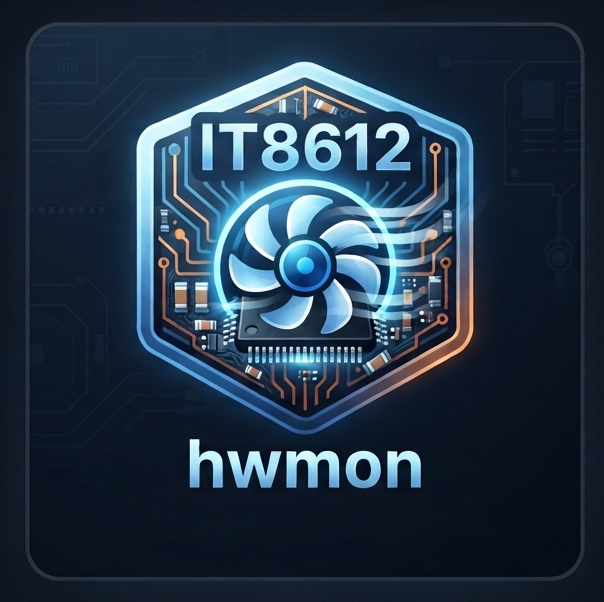

[](https://github.com/EnriquePH/it8612-hwmon/blob/main/LICENSE)
[](https://docs.kernel.org/hwmon/)
[](https://github.com/EnriquePH/it8612-hwmon#tested-hardware)
[](https://github.com/EnriquePH/it8612-hwmon#build-and-install)
[](https://github.com/EnriquePH/it8612-hwmon#safety)

{fig-alt="it8612-hwmon logo" width="300" fig-align="left"}

## Introduction

`it8612-hwmon` is a small, **read-only** Linux kernel module for the ITE
**IT8612E** Super I/O, the chip that measures temperatures and fan speeds on
some OEM desktop boards. No Linux driver supports it, so on those machines
Linux shows no fans at all.

With the driver, monitoring tools such as `sensors`, Prometheus and Grafana can
see the real CPU temperature and warn when a fan stops. It has been tested on
an HP Pavilion 500-526ns desktop (board HP 2B35, AMD A8-6500).

The source code, documentation and releases are on
[GitHub: EnriquePH/it8612-hwmon](https://github.com/EnriquePH/it8612-hwmon).

## The problem

- `sensors-detect` finds the chip but cannot name it: *"Found unknown chip with
  ID 0x8612"*.
- The in-kernel [`it87`](https://docs.kernel.org/hwmon/it87.html) driver and
  the out-of-tree [frankcrawford/it87](https://github.com/frankcrawford/it87)
  do not list ID `0x8612`, so `modprobe it87` fails with *No such device*.
- On AMD family 15h CPUs (A-series APUs), the only CPU sensor, `k10temp`,
  reports **Tctl**: a control value relative to the throttling limit, not
  degrees. It reads 0 at idle. The real temperature comes from a thermistor
  wired to the Super I/O.

The usual workaround, `modprobe it87 force_id=0x8603`, treats the chip as the
related IT8603E. It works, but it relies on a test-only parameter and the
driver writes several configuration registers when it loads.

## Finding the registers without a datasheet

ITE does not publish its datasheets. The register map was established by
dumping the 256 registers of the chip's environment controller with `isadump`
at rest, under full load on all CPU cores and while cooling down, and seeing
which ones moved:

| Register | At rest | 90 s at full load | Cooling down | Reading |
| --- | --- | --- | --- | --- |
| `0x29` | 26 | 38 | 31 | CPU thermistor, °C |
| `0x2a` | 28 | 28 | 28 | Board, °C |
| `0x2b` | 0 | 24 | 4 | Tctl, equal to `k10temp` |
| `0x0e`, `0x19` | | | | Fan 2, about 935 rpm |
| `0x0f`, `0x1a` | | | | Fan 3, about 850 rpm |

The map is the one of the IT87 family (IT8603E, IT8613E), and `it87` with
`force_id=0x8603` gives the same values. The BIOS leaves all three fans in the
chip's own automatic mode, driven by the Tctl: they never stop and speed up
from Tctl 25–30.

## What the driver does

It identifies the chip by its own ID and exposes, through the standard hwmon
interface (`sensors`, `/sys/class/hwmon`, Prometheus node_exporter):

```text
$ sensors it8612-isa-*
it8612-isa-0600
Adapter: ISA adapter
fan1:           0 RPM
fan2:         945 RPM
fan3:         852 RPM
temp1:        +28.0°C
temp2:        +30.0°C
temp3:         +1.0°C
```

It **never writes** to the environment controller, so the fans stay under the
chip's automatic control. The only writes are the standard Super I/O
configuration sequence used once at load time to find the controller, the same
one `sensors-detect` and `it87` use. The code passes the kernel's
`checkpatch.pl --strict` with no errors, warnings or checks, and builds with
`W=1` without warnings.

On the tested board, under a ten-minute full load, the CPU went from 27 °C to a
steady 50 °C, and the fans sped up by themselves from about 935/850 to
2122/1366 rpm.

## Installation

Kernel headers and DKMS (Debian/Ubuntu):

```bash
sudo apt install linux-headers-$(uname -r) dkms build-essential
git clone https://github.com/EnriquePH/it8612-hwmon.git
cd it8612-hwmon
make build
sudo insmod ./it8612.ko
sensors it8612-isa-*
```

To install it for good, rebuilt with every kernel update and loaded at boot:

```bash
sudo make dkms-install
echo it8612 | sudo tee /etc/modules-load.d/it8612.conf
```

## Tested hardware

| Machine | Board / BIOS | CPU | Kernel |
| --- | --- | --- | --- |
| HP Pavilion 500-526ns | HP 2B35, AMI 80.06 (2015) | AMD A8-6500 | 6.12 (Debian 13) |

Reports from other boards are welcome as GitHub issues, with the output of
`sensors` and, if possible, a register dump.

## Disclaimer

The driver is provided **as is, without any warranty** (GPL, sections 11 and
12): use it at your own risk. It has been tested on one board only, and it does
not control the fans or protect the hardware. See the
[full disclaimer](https://github.com/EnriquePH/it8612-hwmon#disclaimer).

## License

GPL-2.0-or-later. Super I/O access follows `drivers/hwmon/it87.c` from the
Linux kernel.

## Links

- [GitHub - EnriquePH/it8612-hwmon](https://github.com/EnriquePH/it8612-hwmon)
- [Project page](https://enriqueph.github.io/it8612-hwmon/)
- [Linux kernel - it87 driver](https://docs.kernel.org/hwmon/it87.html)
- [Linux kernel - hwmon subsystem](https://docs.kernel.org/hwmon/)
- [frankcrawford/it87 (out-of-tree it87)](https://github.com/frankcrawford/it87)
